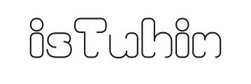
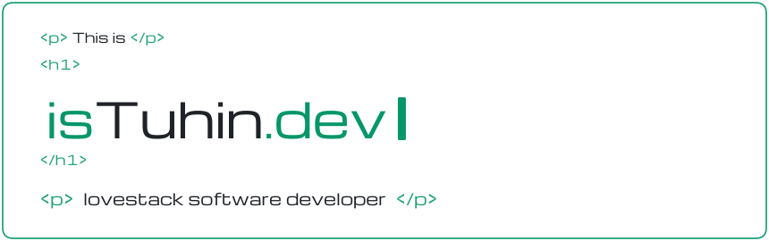
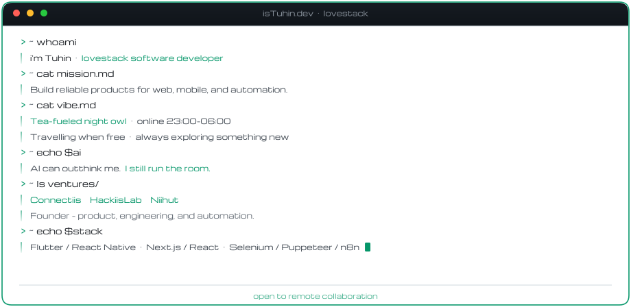

  <picture>
    <source media="(prefers-color-scheme: dark)" srcset="./banner-logo.svg" />
    <source media="(prefers-color-scheme: light)" srcset="./banner-logo-light.svg" />
    
  </picture>

  <picture>
    <source
      media="(prefers-color-scheme: dark)"
      srcset="https://readme-typing-svg.demolab.com?font=Michroma&weight=400&size=22&duration=3000&pause=1000&color=00FF99&center=true&vCenter=true&width=900&height=48&lines=Full-Stack+Web+Developer;Flutter+and+React+Native;Web+Automation+Specialist;Always+Learning+and+Building"
    />
    <source
      media="(prefers-color-scheme: light)"
      srcset="https://readme-typing-svg.demolab.com?font=Michroma&weight=400&size=22&duration=3000&pause=1000&color=059669&center=true&vCenter=true&width=900&height=48&lines=Full-Stack+Web+Developer;Flutter+and+React+Native;Web+Automation+Specialist;Always+Learning+and+Building"
    />
    
  </picture>

  <picture>
    <source media="(prefers-color-scheme: dark)" srcset="./header-card.svg" />
    <source media="(prefers-color-scheme: light)" srcset="./header-card-light.svg" />
    
  </picture>

  <picture>
    <source media="(prefers-color-scheme: dark)" srcset="./terminal-profile.svg" />
    <source media="(prefers-color-scheme: light)" srcset="./terminal-profile-light.svg" />
    
  </picture>

### Connect

  
  
  
  
  
  
  
  

### Ecosystem

**Languages**

  
  
  
  
  
  

**Frameworks**

  
  
  
  
  

**Backend**

  
  
  
  
  
  

**Automation and tools**

  
  
  
  
  

### GitHub Analytics

  <picture>
    <source media="(prefers-color-scheme: dark)" srcset="https://github-profile-summary-cards.vercel.app/api/cards/stats?username=istuhin&theme=github_dark" />
    <source media="(prefers-color-scheme: light)" srcset="https://github-profile-summary-cards.vercel.app/api/cards/stats?username=istuhin&theme=github" />
    
  </picture>
  <picture>
    <source media="(prefers-color-scheme: dark)" srcset="https://github-profile-summary-cards.vercel.app/api/cards/repos-per-language?username=istuhin&theme=github_dark" />
    <source media="(prefers-color-scheme: light)" srcset="https://github-profile-summary-cards.vercel.app/api/cards/repos-per-language?username=istuhin&theme=github" />
    
  </picture>

  <picture>
    <source media="(prefers-color-scheme: dark)" srcset="https://github-profile-summary-cards.vercel.app/api/cards/most-commit-language?username=istuhin&theme=github_dark" />
    <source media="(prefers-color-scheme: light)" srcset="https://github-profile-summary-cards.vercel.app/api/cards/most-commit-language?username=istuhin&theme=github" />
    
  </picture>

  <picture>
    <source media="(prefers-color-scheme: dark)" srcset="https://github-profile-summary-cards.vercel.app/api/cards/profile-details?username=istuhin&theme=github_dark" />
    <source media="(prefers-color-scheme: light)" srcset="https://github-profile-summary-cards.vercel.app/api/cards/profile-details?username=istuhin&theme=github" />
    
  </picture>

### Certifications

  

  <strong>Building the future, one line of code at a time</strong> 
  © 2026 Touhidur Rahman (dev.isTuhin) · lovestack

